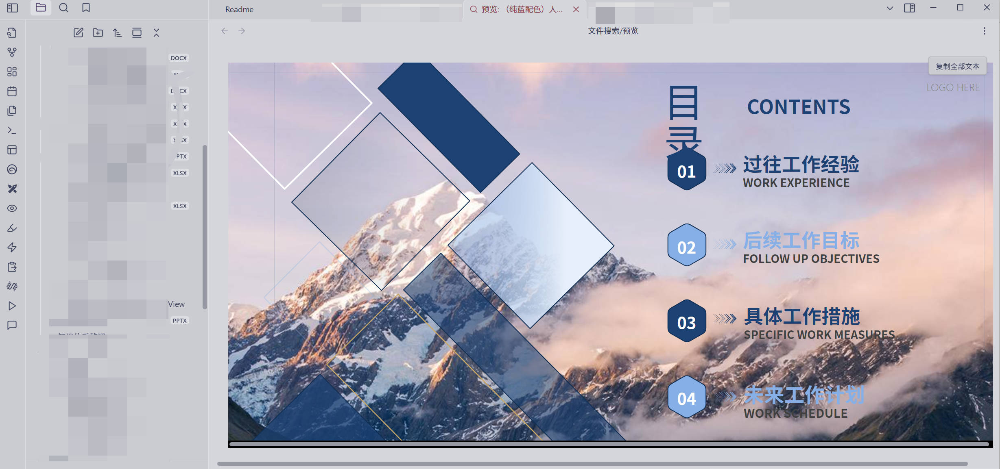

# Show Me Anything

Show Me Anything 是一个 Obsidian 本地文档查看插件。文件只在当前设备中读取和保存，不需要 Office、WPS 或服务器。



## 文件支持

| 格式 | 查看 | 编辑 |
| --- | --- | --- |
| `.docx` | 分页、表格、图片、页眉页脚 | 正文、标题、列表、简单表格和常用文字格式 |
| `.pptx` | 连续显示幻灯片 | 现有文本框的文字和常用文字格式 |
| `.xlsx` | 工作表、合并单元格、常用样式、分页浏览 | 单元格值、公式、常用格式、行高和列宽 |
| `.xls` | 工作表分页浏览 | 单元格值和公式 |
| `.pdf` | 缩略图、目录、跳页、缩放、旋转、搜索、复制、单页、连续阅读、全屏和打印 | 不支持 |
| `.doc`、`.ppt` | 提示转换为新版格式 | 不支持 |

Windows、macOS、Linux、Android 和 iOS 使用相同的文件处理代码。移动端会缩小工具栏和页面间距。

## 使用

在文件列表中点击受支持的文件即可打开查看页。也可以右键点击文件，选择用 Show Me Anything 打开。查看页顶部的使用默认应用打开按钮会把原文件交给系统处理。

DOCX、PPTX、XLSX 和 XLS 查看页顶部有编辑按钮。进入简化编辑模式后：

1. 选择需要修改的段落、文本框或单元格。
2. 修改内容或使用格式工具。
3. 点击保存写入原文件，点击取消放弃本次修改。

插件不会自动保存，也不会生成备份。编辑期间如果源文件被其他程序修改，保存会停止，并要求重新打开文件。

## 限制

- DOCX 和 PPTX 只修改允许编辑的 XML 节点，图片、版式、动画等内容保持原样。
- 带修订记录、编辑保护或数字签名的文件只能查看。
- XLS 是旧版二进制格式，仅开放单元格内容和公式编辑。
- 图表、数据透视表、宏、Office 动画、PDF 表单及批注不提供编辑能力。
- 不支持加密文件，不执行宏。
- 名称以 `~$` 开头的文件是 Office 临时文件，插件会提示打开对应的原文件。
- 预览结果可能与 Microsoft Office 有少量排版差异，尤其是设备缺少原字体时。

## 安装

从 GitHub Release 下载 `main.js`、`manifest.json` 和 `styles.css`，放入：

```text
<Obsidian 仓库>/.obsidian/plugins/ob-show-me-anything/
```

重启 Obsidian，然后在第三方插件设置中启用 Show Me Anything。

## 开发

需要 Node.js 20 或更高版本。

```bash
npm install
npm run dev
```

提交前运行：

```bash
npm run check
```

部署到测试仓库：

```bash
npm run deploy -- <Obsidian 仓库路径>
```

准备 GitHub Release 文件：

```bash
npm run release:prepare
```

生成结果位于 `release/ob-show-me-anything/`。

## 依赖

- [docx-preview](https://github.com/VolodymyrBaydalka/docxjs)
- [pptx-preview](https://www.npmjs.com/package/pptx-preview)
- [SheetJS](https://docs.sheetjs.com/)
- [PDF.js](https://mozilla.github.io/pdf.js/)
- [JSZip](https://stuk.github.io/jszip/)

## 许可证

[MIT](LICENSE)
